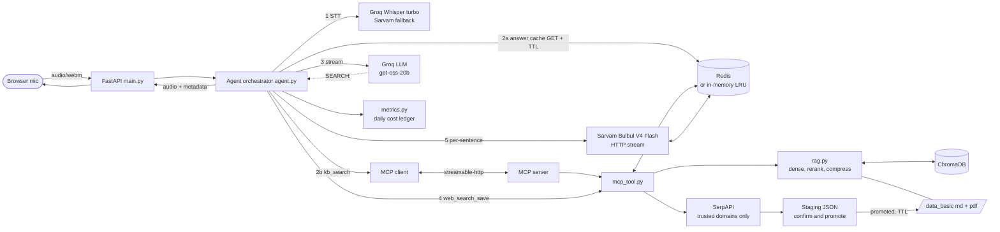
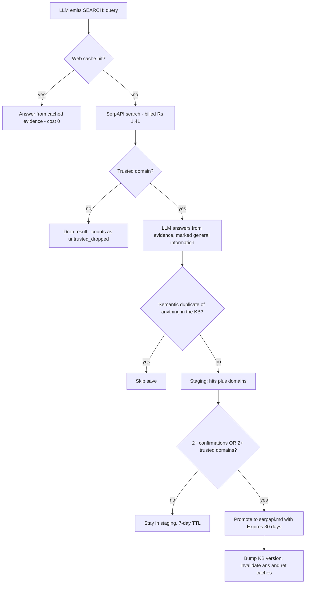

<div align="center">

# RxE Voice AI — V2

### Cost- and latency-engineered multilingual voice assistant for Healthcare & Medical E-Commerce

*Speak in your language → grounded spoken answer. Every rupee and every millisecond is measured, logged and cached.*


**[V1 repository](https://github.com/krishkydv77/RxE-Voice-AI)** · **V2 (this repository)**

</div>


## 1. What is RxE Voice AI?

RxE Voice AI is a **voice-first assistant for healthcare and medical e-commerce**. A user speaks a question (Hindi, English or another supported Indian language); the system transcribes it, retrieves grounded facts from a curated knowledge base, generates a short answer, and speaks it back **in the same language**.

When the knowledge base cannot answer, the agent falls back to a **governed live web search** (SerpAPI, restricted to trusted medical domains), answers from that evidence, and — only after confirmation rules pass — promotes the answer into the knowledge base.

**V1** proved the idea. **V2** is the *engineering* release: it turns the prototype into something you can operate, because every stage now has a **real cost**, a **latency number**, a **cache policy** and a **log line**.

> RxE Voice AI is an informational assistant. It is not a substitute for a doctor. See [Security & medical safety](#21-security--medical-safety).


## 2. V2 at a glance

### 2.1 Feature comparison

| Area | V1 | V2 | Why V2 is better |
|---|---|---|---|
| **STT** | Sarvam `saarika:v2.5` | **Groq Whisper large-v3-turbo**, Sarvam as automatic fallback; Hindi mis-detected as Urdu is retried with `language=hi` | ~4–8× cheaper per clip (≈ ₹0.0104 for a ≤10 s clip vs ≈ ₹0.04 for 5 s on Saarika), faster, and resilient |
| **TTS** | Sarvam `bulbul:v3`, REST, base64 WAV | **`bulbul:v4-flash`**, HTTP **streaming** endpoint, MP3 @ 64 kbps, REST fallback | ₹30 → ₹20 per 10 k characters (−33 %), smaller payloads, TTFB measured per sentence |
| **LLM** | Single non-streaming-style call, `temperature 0.2` | **Streaming with TTFT tracking**, TTFT timeout guard, `temperature 0`, compact prompt, history only on follow-ups | Sentence-level TTS can start while the LLM is still generating; no request can hang on a slow first token |
| **Caching** | None | **4 cache layers** (answer, retrieval, web, TTS) on **Redis with in-memory LRU fallback**, KB-version-aware keys | Repeat questions skip LLM, retrieval, web and TTS; see [§7](#7-caching-ttl--redis-metrics) |
| **Retrieval** | Top-3 chunks, up to 1 800 chars | **Dense search → cross-encoder rerank → extractive compression → dynamic top-k → one-hit mode**, 420-char context cap | Fewer, better tokens; faster LLM; higher precision |
| **Web fallback** | Any result accepted, auto-saved, flat ₹0.40 cost estimate | **Trusted-domain allowlist**, **staging layer**, promotion rules, entry **TTL**, curated-over-web ranking, **semantic de-duplication against the whole KB**, real ₹1.41 billing | Medical claims come from WHO/NIH/CDC-class sources only; the KB cannot be polluted by one noisy search |
| **Cost accounting** | Placeholder constants (₹83/USD, ₹0.40 search, ₹0.05 infra) | **Real published rates**, billed-flag aware (cached = free, empty result = billed), Whisper min-billing and retry double-billing handled, **daily ledger** | You can reconcile against invoices |
| **Language** | TTS language inferred from reply script | **TTS language forced = STT language**; explicit reply-language instruction; `language_mismatch` metric; Hinglish aware | Same-language reply is enforced, not hoped for |
| **Observability** | Latency summary | Per-stage logs, **cache hit/miss + TTL + ms per operation**, Redis `INFO`, TTFT, cost-per-word / per-audio-second, daily cost, `/api/metrics` | Every decision is explainable from the logs |
| **Tool layer** | MCP tools | MCP tools + `#meta` side-channel (cache hit, TTL, coverage, rerank timing) returned with every `kb_search` | Cache and retrieval diagnostics survive the MCP boundary |
| **Resilience** | MCP fallback | + Redis outage → memory fallback (30 s retry), TTS stream → REST fallback, LLM TTFT timeout → safe reply, a failed TTS sentence no longer fails the request | Degrades instead of crashing |

### 2.2 Cost & latency scoreboard

| Metric | V1 (modelled with V1's own constants) | V2 (measured on the dev machine, §14) |
|---|---|---|
| Cost of a typical KB answer (~90 spoken characters) | ≈ ₹0.33 (₹0.27 TTS + ₹0.05 flat infra + STT/LLM) | **₹0.209 average** (n = 19) |
| Cost of a repeat question (answer-cache hit, TTS cached) | no cache → full cost every time | **₹0.0104** (STT only), **first audio 734 ms** |
| SerpAPI cost per billed search | ₹0.40 *(assumed)* | **₹1.41** *(real: $75 / 5 000 searches × ₹94)* |
| TTFT visibility | not measured | measured per request (median **857 ms**, `gpt-oss-20b`) |
| Per-request cost breakdown | estimated | real rates + daily ledger |

> **Honesty note.** The design target is *time-to-first-audio ≤ 2 000 ms*. The measured median on the development machine is **≈ 3.0 s** for KB answers (see [§14](#14-measured-results)); the cache path already reaches **0.73 s**. §20 lists exactly what separates the current numbers from the target. V1's numbers are modelled, not measured — V1 shipped no measurements.


## 3. System architecture



**Layers**

| Layer | Responsibility |
|---|---|
| `main.py` | HTTP API, request IDs, sessions (LRU, 200), NDJSON streaming, `/api/metrics` |
| `agent.py` | Orchestration, prompts, language policy, TTFT, sentence streaming, cost & latency accounting |
| `voice.py` | STT/TTS clients, Groq client, real-rate cost helpers, TTS cache |
| `cache.py` | Redis/LRU cache with per-operation metrics, TTL, KB-version keys |
| `rag.py` | Chunking, embeddings, ChromaDB, rerank, compression, semantic duplicate detection |
| `mcp_tool.py` / `mcp_server.py` / `mcp_client.py` | KB search, reindex, governed web search; MCP transport with retry/reconnect |
| `query_opt.py` | Local (no-LLM) query compression, small-talk detection, cache-key normalisation |
| `metrics.py` | Persistent daily cost ledger |
| `logger.py` | Request-ID aware logging, JSONL metrics, `Timer` |


## 4. Request pipeline

```text
audio ─► STT ─► local query compression ─► [long query? intent-summary ‖ retrieval]
      ─► answer-cache lookup ─► (hit) ──────────────────────────────► TTS-cache ─► audio
                              └ (miss) ─► retrieval (cached) ─► LLM stream ─┬─► sentence 1 ─► TTS ─┐
                                                                            ├─► sentence 2 ─► TTS ─┼─► ordered audio
                                                                            └─► "SEARCH: q" ─► web (trusted) ─► LLM ─► TTS
```

1. **STT** — Groq Whisper (`whisper-large-v3-turbo`); silence detection via `no_speech_prob`; Urdu/Hindi retry; automatic Sarvam fallback.
2. **Local query optimisation (free)** — filler/stutter removal, greeting stripping, small-talk detection (`query_opt.py`).
3. **Intent summary (only for long queries, > 25 words)** — a short LLM rewrite that runs **in parallel with retrieval**; numbers, order IDs and Capitalised entities lost by the rewrite are restored by a guard.
4. **Answer cache** — keyed on `KB version + language + normalised query`; follow-up turns (short or pronoun-bearing) bypass it.
5. **Retrieval** — cached; dense → rerank → compress → dynamic top-k.
6. **LLM (streaming)** — compact prompt, TTFT measured, TTFT timeout guard; complete sentences are pushed to TTS **while the LLM is still generating** (first sentence may split on a comma after 20 chars).
7. **Web fallback** — if the LLM emits `SEARCH: <english query>`: governed SerpAPI search → second LLM call grounded on the evidence → background save to staging.
8. **TTS** — one task per sentence, parallel, per-sentence TTS cache, ordered emission, REST fallback.
9. **Accounting** — real cost, latency, cache and language metrics are logged and returned.

**Response `path` values**

| `path` | Meaning |
|---|---|
| `kb` | Answered from the knowledge base |
| `cache` | Served from the answer cache (no LLM, no retrieval) |
| `smalltalk` | Greeting / thanks; no retrieval |
| `web` | Answered from governed web evidence |
| `web_failed` | KB had no answer and the web returned nothing trusted → safe fallback text |
| `web_llm_failed`, `llm_empty` | LLM produced nothing valid → safe fallback text |
| `empty` | Silence / empty transcript (STT cost still recorded) |


## 5. Cost engineering

### 5.1 Real rates (verified 21 Nov 2026 — all overridable via env)

| Component | Rate | Env / location |
|---|---|---|
| USD → INR | ≈ ₹94 | `USD_INR` |
| Sarvam TTS — Bulbul V4 Flash | ₹20 per 10 000 characters (₹0.002 / char) | `SARVAM_TTS_INR_PER_10K_CHARS` |
| Groq Whisper large-v3-turbo | $0.04 per audio hour, **10 s minimum per request** | `WHISPER_USD_PER_HOUR`, `WHISPER_MIN_BILLED_SEC` |
| Sarvam STT (fallback only) | ₹0.49 per minute, billed per second (rounded up) | `SARVAM_STT_INR_PER_MIN` |
| Groq `gpt-oss-20b` | $0.075 in / $0.30 out per 1 M tokens | `GROQ_RATE_IN_USD`, `GROQ_RATE_OUT_USD` |
| SerpAPI (Developer plan) | $75 / 5 000 searches = **₹1.41 per billed search** | `SERPAPI_PLAN_USD`, `SERPAPI_PLAN_SEARCHES` |
| Redis / ChromaDB / embedder / reranker | self-hosted → ₹0 marginal | `OTHER_INFRA_COST_INR` (set to *server bill ÷ monthly requests*) |

### 5.2 Billing rules the code implements

- **Cached results are free** (answer, retrieval, web, TTS) and are logged with the cost they *saved*.
- **A fresh SerpAPI request is billed even when no trusted result survives the filter** (`web_failed` still costs ₹1.41).
- **Whisper is billed with a 10-second minimum**, and a Hindi **retry after Urdu mis-detection bills both calls**.
- **TTS is billed per character actually sent**, per sentence; a cached sentence costs ₹0.
- **Reasoning tokens count as output tokens** for `gpt-oss` models and are included.

### 5.3 Where the money goes (measured, 29 requests)

| Component | ₹ | Share |
|---|---|---|
| SerpAPI (6 billed searches; 7 web attempts, 1 served from the negative cache) | 8.46 | **63.1 %** |
| TTS | 4.60 | 34.3 % |
| STT | 0.30 | 2.3 % |
| LLM | 0.05 | 0.4 % |
| **Total** | **13.41** | |

**Insight that drives the design:** the LLM is essentially free. **Web search and TTS are the cost.** Every optimisation therefore targets *avoiding a SerpAPI call* or *avoiding re-synthesising audio*.

### 5.4 Cost levers implemented

| Lever | Effect |
|---|---|
| Answer cache + TTS cache | Repeat question costs ₹0.0104 (STT only) instead of ≈ ₹0.2 |
| TTS cache per sentence, 7-day TTL | Shared sentences across answers cost ₹0 |
| Fallback-line TTS pre-warm at startup | The fixed "couldn't find" lines cost ₹0 at runtime |
| Web cache (24 h) + negative cache | Same question never triggers two paid searches |
| Staging → promotion → KB | A confirmed web answer is served from the KB next time — SerpAPI is paid once |
| Semantic de-duplication against the **whole** KB | Never pay to store what is already known |
| Trusted-domain filter | Avoids storing unusable results (but see §20 on filter-induced waste) |
| Short replies (`REPLY_MAX_WORDS=15`, `LLM_MAX_TOKENS`) | Fewer TTS characters — the largest per-request cost |
| Bulbul V4 Flash | −33 % per character vs V3 |
| Whisper instead of Saarika | ≈ 4–8× cheaper STT |
| Compact prompt, history only on follow-ups, 420-char context | Fewer input tokens |

### 5.5 Cost formulas (as implemented)

```text
STT   = max(duration_s, 10) / 3600 × $0.04 × USD_INR           (Whisper)
TTS   = characters_sent × ₹20 / 10 000
LLM   = (prompt_tokens × $in + completion_tokens × $out) / 1e6 × USD_INR
WEB   = ($75 / 5 000) × USD_INR   if the search was fresh (not cached) else 0
TOTAL = STT + LLM + TTS + WEB + OTHER_INFRA

cost_per_word         = TOTAL / reply_words
cost_per_second_audio = TOTAL / output_audio_seconds        (from real audio bytes)
```


## 6. Latency engineering & TTFT

### 6.1 Budget

| Stage | Typical (measured median) | Notes |
|---|---|---|
| STT (Groq Whisper) | **729 ms** | network + decode of a 4–7 s clip |
| Retrieval via MCP (cold) | **417 ms** | embedding + dense + rerank; **≈ 1–3 ms** on a cache hit |
| LLM **TTFT** (`gpt-oss-20b`) | **857 ms** | first *content* token (reasoning model) |
| TTS time-to-first-byte (Bulbul V4 Flash stream) | **598 ms** | per sentence, then full-sentence collection |
| **Time to first audio** (KB path) | **≈ 2 985 ms** | target ≤ 2 000 ms — see §20 |
| **Time to first audio** (answer-cache path) | **734 ms** | no retrieval, no LLM, TTS from cache |

### 6.2 TTFT — how it is used

- Measured on every streamed LLM call: `ttft_ms` (from the call) and `ttft_abs_ms` (from the request start).
- Compared with `TTFT_TARGET_MS` (default 500 ms) → **WARNING** when exceeded.
- **TTFT timeout guard** (`LLM_TTFT_TIMEOUT_S`): if no content token arrives in time, the request does not hang — the safe fallback reply is spoken and `llm_empty` is recorded.
- `first_audio_ms ≈ STT + retrieval + TTFT + first-sentence time + TTS TTFB` — the `LATENCY SUMMARY` log line prints each term so the bottleneck is visible at a glance.

### 6.3 Techniques implemented

| Technique | Where |
|---|---|
| LLM streaming → **sentence-level TTS while the LLM is still generating** | `agent._chat_stream`, `_TTSStream` |
| First chunk may split on a comma (`FIRST_CLAUSE_MIN_CHARS`) | `SentenceSplitter` |
| **Parallel:** intent-summary ‖ retrieval (long queries) | `_run_voice` |
| **Parallel:** TTS synthesis per sentence, ordered emission | `_TTSStream` |
| **Parallel:** startup warm-up (retrieval, Groq, Sarvam, Redis, TTS pre-warm) | `agent.warmup` |
| GET + TTL in a single Redis pipeline round-trip | `cache.aget_ex` |
| KB-version memoised for 5 s (saves a Redis RTT per request) | `cache.akb_version` |
| HTTP/2 connection pooling, keep-alive | `voice.http_client` |
| Rerank pool of 6, rerank text 600 chars, skip when the top hit is confident | `rag.retrieve` |
| `one_hit` mode: confident top hit → send **one** chunk | `rag.retrieve` |
| Non-blocking background writes (cache sets, staging, KB save) | `_spawn` |
| LLM TTFT timeout, TTS stream → REST fallback | `agent`, `voice` |


## 7. Caching, TTL & Redis metrics

### 7.1 Cache layers

| Layer | Key | Default TTL | Purpose |
|---|---|---|---|
| **Answer** (`ans`) | KB version + language + normalised query | `ANSWER_CACHE_TTL` = 1 800 s | Skip retrieval + LLM |
| **Retrieval** (`ret`) | KB version + top-k + **order-free content terms** | `RETRIEVAL_CACHE_TTL` = 1 800 s | Rephrased queries share one entry |
| **Web** (`web`) | language + order-free content terms | `WEB_CACHE_TTL` = 86 400 s (24 h) | Never pay twice for the same search |
| **Web negative** | same | `WEB_NEG_CACHE_TTL` = 1 800 s | Do not retry a known-empty search immediately |
| **TTS** (`tts`) | provider + model + speaker + codec + language + text | `TTS_CACHE_TTL` = 604 800 s (7 days) | Re-synthesis costs ₹0 |
| **KB version** | `PREFIX:kbver` | persistent | Reindex/promotion invalidates all `ans`/`ret` keys instantly |

Backend: **Redis** when `REDIS_URL` is set and reachable; otherwise a thread-safe **in-memory LRU** (`CACHE_MEM_MAX`). A Redis failure switches to memory for 30 s and then retries — the app never crashes on a cache outage.

### 7.2 Other TTLs in the system

| Object | TTL | Setting |
|---|---|---|
| Web answer staging entry | 7 days | `WEB_STAGING_TTL_DAYS` |
| Promoted web entry in the KB (`Expires:` metadata) | 30 days | `WEB_TTL_DAYS` |
| Expired web chunks | ignored at retrieval and purged at startup/reindex | `rag.purge_expired` |
| Local KB-version memo | 5 s | `KBVER_LOCAL_TTL_S` |

### 7.3 TTL & Redis observability

Every cache operation logs `kind`, `hit`, `backend`, `ms`, and **remaining TTL**; the pipeline summary reports:

`redis_hit`, `retrieval_cache_hit`, `redis_get_ms`, `redis_set_ms`, `cache_ttl_sec`, `retrieval_cache_ttl_sec`, `tts_cache_ttl_sec`, `cache_hits_by_kind`, `cache_hit_rate`.

`GET /api/metrics` and a periodic `CACHE STATS` log (default every 5 min) additionally expose **Redis `INFO`**: ping latency, used memory, key count, connected clients, ops/sec, evictions, expirations, and the **server-side hit ratio**, next to the application-level hit rate per cache kind and average / p95 GET and SET latency.


## 8. Token engineering

Goal: **minimum input tokens without losing answer accuracy**.

| Technique | Detail |
|---|---|
| Compact system prompt | One short base rule + a per-mode suffix (KB / web / small-talk) |
| Context cap | `CONTEXT_MAX_CHARS` = 420 characters after compression |
| **History only when needed** | Included only for short or pronoun-bearing queries ("iska price?"), 1 exchange × `HISTORY_MSG_CHARS` |
| Web-entry metadata stripped | `Saved on / Origin / Expires / Domains / Links …` lines never reach the LLM |
| Intent summary for long queries | Parallel with retrieval; entity-preservation guard |
| `LLM_MAX_TOKENS` + 15-word reply limit | Fewer output tokens and fewer TTS characters |
| `temperature = 0` | Same context + question → same reply → higher TTS cache hit rate |
| Budget enforcement | `PROMPT BUDGET` log before every call; `prompt_over_budget` in the summary |


## 9. Retrieval quality

```text
query ─► ChromaDB dense search (multilingual MiniLM, cosine) ─► MIN_SCORE filter
      ─► curated-over-web ranking (web score × 0.90; curated hit ≥ 0.55 drops web hits)
      ─► cross-encoder rerank (English queries; skipped when confident or non-Latin)
      ─► dynamic top-k + score-gap cut ─► one-hit mode ─► extractive compression (≤ 420 chars)
```

| Mechanism | Purpose |
|---|---|
| Header-aware Markdown chunking with section-path prefix, page-aware PDF chunking | Context-rich chunks |
| Script-aware separators incl. the Devanagari **danda (।)** | Hindi sentences stay intact |
| Incremental SHA-256 manifest sync | Only changed files are re-embedded |
| Rerank (`Xenova/ms-marco-MiniLM-L-6-v2`, English-only) | Precision; skipped for Hindi queries and for confident dense hits |
| Dynamic top-k (2 for short queries, up to 3) + `DENSE_MARGIN` | Fewer, more relevant chunks |
| `one_hit` (score ≥ 0.80 and gap ≥ 0.10) | One chunk instead of three when the answer is unambiguous |
| Extractive compression | Keeps the sentences that matter for the query |
| Expired-web-chunk filtering | Stale web knowledge never reaches the LLM |

**Precision / recall**

- *Online proxies* (every request): `retrieval_k`, `retrieval_reranked`, `retrieval_one_hit`, `retrieval_term_coverage` (recall proxy, Latin queries), `retrieval_avg_score`.
- *Offline evaluation:* `eval_retrieval.py` computes **precision@k, recall@k, MRR**, average context size and latency from `eval_set.json`, with a `--k 1,2,3` sweep.

```bash
python eval_retrieval.py --set eval_set.json --k 1,2,3
```


## 10. Governed web fallback



| Control | Behaviour |
|---|---|
| **Trusted-domain allowlist** | `who.int, nih.gov, cdc.gov, fda.gov, medlineplus.gov, mayoclinic.org, nhs.uk, clevelandclinic.org, health.harvard.edu, hopkinsmedicine.org, icmr.gov.in, mohfw.gov.in, cdsco.gov.in, nhp.gov.in` (`TRUSTED_DOMAINS`); `WEB_STRICT=1` filters answer boxes, knowledge graph and organic results |
| **Staging layer** | New answers wait in `vectordb/web_staging.json`; the same question (Jaccard ≥ 0.8) confirmed again, or evidence from ≥ 2 distinct trusted domains, promotes it |
| **Source metadata + TTL** | Each promoted entry stores `Saved on`, `Origin: web`, `Expires`, `Domains`, `Confirmed`, `Search query`, `Links` |
| **Curated-over-web ranking** | Web chunks are down-weighted (× 0.90); a strong curated hit drops web hits entirely |
| **Semantic de-duplication** | Before staging *and* before saving, the Q+A meaning is compared (cosine ≥ 0.88) against the **entire** KB; duplicates are skipped |
| **Cost-aware** | A web search happens only when the KB cannot answer; results are cached for 24 h |


## 11. Language handling

- **Forced `tts_lang = stt_lang`** — the spoken reply always uses the language the user spoke.
- The LLM receives an **explicit** instruction: `Hindi (Devanagari script)`, `Hinglish (Hindi in Roman script)` when the question was Romanised, `English`, or the matching Indian language.
- `language_mismatch` compares the *script of the reply* with the expected script (Hinglish aware) and is logged as a WARNING when it fires.
- 11 Indian language codes are supported for TTS: `hi-IN, en-IN, bn-IN, gu-IN, kn-IN, ml-IN, mr-IN, od-IN, pa-IN, ta-IN, te-IN`.

---

## 12. Metrics reference

Every response carries `metadata` (also written to `logs/metrics.jsonl`). Example (real shape, abbreviated):

```json
{
  "path": "kb", "response_language": "en-IN", "language_mismatch": false,
  "redis_hit": false, "redis_get_ms": 2.96, "redis_set_ms": 13.16, "cache_ttl_sec": 1800,
  "retrieval_cache_hit": false, "cache_hit_rate": 21.1,
  "ttft_ms": 687.2, "ttft_abs_ms": 1844.7, "tts_ttfb_ms": 604.8, "first_audio_ms": 2730.6, "total_ms": 3019.8,
  "stt_cost_inr": 0.010444, "llm_cost_inr": 0.001848, "tts_cost_inr": 0.176, "web_cost_inr": 0.0,
  "total_cost_inr": 0.188292, "cost_per_word": 0.01448, "cost_per_second_audio": 0.03875,
  "prompt_tokens": 302, "completion_tokens": 57, "tokens_per_word": 4.38,
  "retrieval_k": "2", "retrieval_reranked": true, "retrieval_term_coverage": 0.4,
  "daily_cost": 4.5278, "daily_requests": 17, "daily_avg_cost": 0.2663
}
```

| Metric | Definition |
|---|---|
| `ttft_ms` / `ttft_abs_ms` | LLM time-to-first-content-token from the call / from request start |
| `first_audio_ms` (`core_ms`) | Request start → first audio sentence ready |
| `tts_ttfb_ms` | Sarvam stream time-to-first-byte for the first sentence |
| `redis_hit` | Answer-cache hit |
| `redis_get_ms` | Sum of cache GET times in this request |
| `redis_set_ms` | Rolling average of recent SET times (SETs are asynchronous) |
| `cache_ttl_sec` | Hit → remaining TTL; miss → TTL that was set |
| `cache_hit_rate` | Application-level hit rate (%) across all cache kinds |
| `response_language`, `language_mismatch` | Spoken language; reply-script check |
| `cost_per_word` | Total ₹ ÷ reply words |
| `cost_per_second_audio` | Total ₹ ÷ synthesised audio seconds (from real byte counts) |
| `tokens_per_word` | Completion tokens ÷ reply words (`total_tokens_per_word` includes the prompt) |
| `daily_cost` | Today's accumulated ₹ (persisted in `logs/daily_cost.json`) |
| `retrieval_term_coverage` | Share of query terms present in the context (recall proxy) |


## 13. Observability & logs

Every step prints a log line tagged with the request ID:

```text
PIPELINE start | transcript | language (stt = tts, forced) | query | history | parallel
CACHE get/set | kind=ans|ret|web|tts hit=… backend=redis ms=… ttl_left=…
MCP call start/done | tool=kb_search …            RETRIEVAL cache HIT/MISS
PROMPT budget | system + context + history + question
LLM start | LLM TTFT | LLM done                   TTS start | TTS cache HIT | TTS done
SERPAPI start/done | trusted-domain filter        WEB staging new/confirm | promoted
LATENCY SUMMARY | COST BREAKDOWN | CACHE SUMMARY | EFFICIENCY | METRICS daily
CACHE STATS (periodic): app hit rates + Redis INFO
```

```text
LATENCY SUMMARY | path=kb | STT=761 retrieval=372 web=0 LLM=709 TTFT=687 TTS_TTFB=605 |
  FIRST AUDIO=2731 ms (target 2000) [OVER TARGET] | TOTAL=3020 ms | COST = ₹0.1883
```

Endpoints for live inspection: `GET /api/health`, `GET /api/metrics` (cache snapshot, Redis `INFO`, today's cost, last 7 days, active rates). MCP-server logs live in `logs/mcp/`.


## 14. Measured results

Source: `logs/metrics.jsonl` and `logs/daily_cost.json` committed with this repository — **29 requests** (24 English, 5 Hindi) recorded on a development machine (Windows, Redis 3.0.504) while the system was being tested. This is a **small, mixed-purpose sample**, not a benchmark; treat the numbers as indicative.

**Latency (ms)**

| Metric | Median | Min | Max |
|---|---|---|---|
| STT | 729 | 627 | 1 175 |
| Retrieval (MCP) | 417 | 0 | 944 |
| LLM TTFT (`gpt-oss-20b`) | 857 | 325 | 1 031 |
| TTS TTFB | 598 | – | 997 |
| First audio — all requests | 3 033 | 734 | 7 676 |
| Total — all requests | 3 298 | 736 | 8 225 |

**By path**

| Path | n | First audio (median) | Avg cost |
|---|---|---|---|
| `cache` (answer cache hit) | 1 | **734 ms** | ₹0.0104 |
| `llm_empty` (fallback reply) | 2 | 1 737 ms | ₹0.0115 |
| `kb` | 19 | 2 985 ms | ₹0.209 |
| `web_failed` | 5 | 4 256 ms | ₹1.140 |
| `web` | 2 | 6 958 ms | ₹1.656 |

**Cost:** 29 requests = **₹13.41** (avg ₹0.46; KB-only avg ₹0.209). SerpAPI = 63 %, TTS = 34 %.

**Cache:** 1 answer-cache hit, 10 of 49 TTS sentences served from cache. The cache is cold in this sample — hit rates are expected to rise with repeated traffic (see the [test plan](#19-test-plan)).

**Reading the numbers**

1. The **cache path is ≈ 4× faster** than the KB path (734 ms vs 2 985 ms) and ≈ 20× cheaper.
2. LLM cost is **0.4 %** of spend — optimise search and TTS, not tokens.
3. The KB path misses the 2 s target mainly because of STT (≈ 0.7 s) + MCP retrieval (≈ 0.4 s) + reasoning-model TTFT (≈ 0.9 s) + TTS TTFB (≈ 0.6 s) in series.
4. The `web` path is slow and expensive; **4 of the 6 billed searches returned nothing from trusted domains** — ₹5.64 of the ₹8.46 SerpAPI spend (§20).


## 15. API reference

Base URL: `http://localhost:8000`

### `POST /api/voice`
`multipart/form-data`: `audio` (file, ≤ 10 MB), `session_id` (string).
Returns the full result after the pipeline completes.

```jsonc
{
  "transcript": "…", "reply": "…", "language": "hi-IN",
  "audios": ["<base64 audio per sentence>"], "audio_mime": "audio/mpeg",
  "path": "kb", "sources": ["…md"],
  "metadata": { /* §12 */ }
}
```

### `POST /api/voice/stream`
Same input; **NDJSON stream** for minimum time-to-first-audio:

| Event | Payload |
|---|---|
| `{"type":"transcript", …}` | transcript + language |
| `{"type":"audio","index":n, "text", "audios", "mime", "language"}` | one event per sentence, in order |
| `{"type":"done", …}` | final reply + `metadata` |
| `{"type":"error","error":"…"}` | failure |

### Other endpoints

| Method | Path | Description |
|---|---|---|
| `GET` | `/` | Web UI |
| `GET` | `/api/health` | Status, tool mode (`mcp` / `in-process`), sources, sessions, cache backend |
| `GET` | `/api/metrics` | Cache snapshot, Redis `INFO`, today's cost, last 7 days, active rates |
| `POST` | `/api/reindex?force=false` | Re-sync the KB and bump the KB version (invalidates caches) |
| `DELETE` | `/api/session/{id}` | Clear a conversation |

Errors: `400` empty audio · `413` audio > 10 MB · `502` upstream failure. Every response carries `X-Request-ID`.


## 16. Configuration reference

All settings are environment variables — copy `env.example` to `.env`. **Never commit `.env`.**

**Keys:** `GROQ_API_KEY`, `SARVAM_API_KEY`, `SERPAPI_API_KEY`, `REDIS_URL` (optional).

| Group | Variable | Default | Meaning |
|---|---|---|---|
| Models | `GROQ_MODEL`, `GROQ_FAST_MODEL` | `llama-3.1-8b-instant` in code; the reference setup uses `openai/gpt-oss-20b` — **set it explicitly in `.env`** (Groq lists the Llama 8B model as Enterprise-only as of Nov 2026) | Chat / summariser models |
| | `LLM_REASONING_EFFORT` | `low` | `gpt-oss` reasoning effort |
| | `SARVAM_TTS_MODEL` / `_SPEAKER` | `bulbul:v4-flash` / `shubh_enhi_ads` | V4 persona speaker IDs |
| | `SARVAM_TTS_STREAM` / `_CODEC` / `_BITRATE` | `1` / `mp3` / `64k` | Streaming transport |
| Latency | `CORE_TARGET_MS` | 2000 | First-audio budget |
| | `TTFT_TARGET_MS` / `LLM_TTFT_TIMEOUT_S` | 500 / 2 | TTFT warning / timeout |
| | `FIRST_CLAUSE_MIN_CHARS` | 20 | Early first-sentence split |
| Tokens | `PROMPT_TOKEN_BUDGET` | 160 | Budget logged per call |
| | `REPLY_MAX_WORDS` / `LLM_MAX_TOKENS` | 15 / 70 | Reply size |
| | `HISTORY_MSGS` / `HISTORY_MSG_CHARS` | 2 / 80 | History window |
| | `QUERY_LLM_WORDS` / `SUMMARY_MAX_WORDS` | 25 / 15 | Intent-summary thresholds |
| RAG | `CHUNK_SIZE` / `CHUNK_OVERLAP` | 500 / 80 | Chunking |
| | `TOP_K` / `TOP_K_MIN` / `RAG_CANDIDATES` | 3 / 2 / 6 | Dynamic top-k, rerank pool |
| | `RAG_MIN_SCORE` | 0.25 | Minimum cosine similarity |
| | `CONTEXT_MAX_CHARS` | 420 | Context cap |
| | `RAG_ONE_HIT_SCORE` / `_GAP` | 0.80 / 0.10 | One-chunk mode |
| Cache | `ANSWER_CACHE_TTL`, `RETRIEVAL_CACHE_TTL` | 1800 | Seconds |
| | `WEB_CACHE_TTL` / `WEB_NEG_CACHE_TTL` | 86400 / 1800 | Found / not-found |
| | `TTS_CACHE_TTL` | 604800 | 7 days |
| | `CACHE_STATS_LOG_S` | 300 | Periodic stats log |
| Web | `WEB_STRICT`, `TRUSTED_DOMAINS` | `1`, list | Domain governance |
| | `WEB_PROMOTE_MIN_HITS` / `_MIN_DOMAINS` | 2 / 2 | Promotion rule |
| | `WEB_STAGING_TTL_DAYS` / `WEB_TTL_DAYS` | 7 / 30 | Staging / promoted lifetime |
| | `SAVE_NEAR_DUP_SCORE` | 0.88 | Semantic duplicate threshold |
| Costs | `USD_INR`, `SARVAM_TTS_INR_PER_10K_CHARS`, `SERPAPI_PLAN_USD`, … | see §5.1 | Real rates |
| Runtime | `USE_MCP`, `MCP_SERVER_URL`, `LOG_DIR`, `LOG_LEVEL`, `HOST`, `PORT` | `1`, … | |

> **Gotcha:** `python-dotenv` keeps the **last** value when a key appears twice in `.env`. Keep each variable defined once.


## 17. Project structure

```text
RxE-Voice-AI-V2/
├── main.py              # FastAPI app, middleware, sessions, NDJSON streaming, /api/metrics
├── agent.py             # Orchestrator: STT → cache → retrieval → LLM stream → web → TTS, metrics
├── voice.py             # Groq/Sarvam clients, STT/TTS, streaming TTS, real-rate cost helpers
├── cache.py             # Redis/LRU cache, TTL, per-op metrics, Redis INFO, KB-version keys
├── metrics.py           # Persistent daily cost ledger
├── rag.py               # Chunking, ChromaDB, rerank, compression, semantic duplicate check
├── query_opt.py         # Local query optimisation, cache-key normalisation
├── mcp_server.py        # MCP server (kb_search, kb_list_sources, kb_reindex, web_search_save)
├── mcp_client.py        # MCP client with timeouts, retry, reconnect
├── mcp_tool.py          # Tool implementations, governed web search, staging & promotion
├── logger.py            # Request-ID logging, JSONL metrics, Timer
├── eval_retrieval.py    # Precision@k / recall@k / MRR evaluation
├── eval_set.json        # Evaluation set template
├── data_basic/          # Knowledge base (.md / .pdf)
├── static/index.html    # Web UI
├── env.example          # Environment template
├── requirements.txt · pyproject.toml · uv.lock
└── logs/ · vectordb/    # Runtime artefacts (git-ignored)
```


## 18. Getting started

**Prerequisites:** Python ≥ 3.12 · API keys for [Groq](https://console.groq.com/), [Sarvam AI](https://www.sarvam.ai/), [SerpAPI](https://serpapi.com/) · Redis *(optional but recommended; Redis ≥ 6 preferred)* · a browser with microphone access.

```bash
git clone https://github.com/krishkydv77/-RxE-Voice-AI-V2.git
cd -RxE-Voice-AI-V2

# install
uv sync                              # or: python -m venv .venv && pip install -r requirements.txt

# configure
cp env.example .env                  # then fill the three API keys (never commit .env)

# add knowledge
cp your_docs/*.md your_docs/*.pdf data_basic/

# run (MCP mode)
redis-server                                                        # optional
python mcp_server.py --transport streamable-http --host 127.0.0.1 --port 8001
python -m uvicorn main:app --reload --port 8000                                                      # http://localhost:8000
```

In-process mode (no MCP server): `USE_MCP=0 python main.py`. If `USE_MCP=1` but the MCP server is down, the app logs the failure and switches to in-process mode automatically. The first request downloads the embedding and rerank models.


## 19. Test plan

Run these in order and watch `logs/app.log` (MCP logs: `logs/mcp/app.log`).

| # | Goal | Ask | Expect |
|---|---|---|---|
| 1 | KB + MCP | "What is B2C in the medical sector?" | `MCP call start | tool=kb_search`, `path=kb` |
| 2 | Answer cache | Repeat #1 | `path=cache`, `redis_hit=true`, TTL ≈ 1 799, `llm_ms=0`, `TTS cache HIT` |
| 3 | Retrieval cache | Ask, wait past `ANSWER_CACHE_TTL`, ask again | `RETRIEVAL cache HIT` |
| 4 | Hindi + forced TTS language | "माइग्रेन के लक्षण क्या होते हैं?" | `reply_language='Hindi…'`, `language_mismatch=false` |
| 5 | Web fallback (topic **not** in KB) | "What are the symptoms of dengue fever?" | `KB answer missing -> web search`, `web_billed=true`, ₹1.41 |
| 6 | Web cache | Repeat #5 | `SERPAPI cache HIT`, web cost ₹0 |
| 7 | Staging → promotion | Repeat #5 after `WEB_CACHE_TTL` expires | `WEB staging confirm hits=2` → entry in `serpapi.md` → next ask answers from the KB |
| 8 | Intent summary ‖ retrieval | A 30+ word question | `PIPELINE parallel | intent-summary ‖ retrieval` |
| 9 | Small talk | "Hello" / "नमस्ते" | `path=smalltalk`, no retrieval |
| 10 | Resilience | Stop `mcp_server.py` / Redis | In-process mode / memory fallback, no crash |

Before testing the web path, confirm the topic is absent from the KB: `grep -ic "dengue" data_basic/*.md`.


## 20. Known limitations & roadmap

These are **measured or observed** issues, listed so they can be prioritised:

| # | Finding | Evidence | Planned fix |
|---|---|---|---|
| 1 | Median KB time-to-first-audio is ≈ 3.0 s vs the 2.0 s target | §14 | Move the UI to `/api/voice/stream`; faster / non-reasoning LLM; reduce prompt size |
| 2 | The bundled UI calls `/api/voice` and plays audio after the full response, so *perceived* latency ≈ total time, not first audio | `static/index.html` | Switch the UI to the NDJSON stream |
| 3 | 4 of 6 billed web searches returned nothing from trusted domains yet each was billed ₹1.41 (₹5.64 of ₹8.46) | `web_failed` rows | Gate obviously non-medical or time-sensitive queries before searching; tune `TRUSTED_DOMAINS` |
| 4 | Web path is slow (median first audio ≈ 7 s, n = 2) | §14 | Lower `SERPAPI_TIMEOUT`, parallelise evidence compression |
| 5 | Prompt exceeds the 160-token budget on every KB request (median 288 prompt tokens) | `prompt_over_budget` | Shorten the system prompt; lower `CONTEXT_MAX_CHARS` |
| 6 | The LLM can ignore "answer only from CONTEXT" and answer from its own knowledge when retrieval returns a weakly related chunk | observed during testing | Deterministic grounding gate (score/coverage + time-sensitive query detector) instead of relying on the model to emit `SEARCH:` |
| 7 | `gpt-oss-20b` is a reasoning model → TTFT ≈ 0.86 s | §14 | Benchmark alternatives against `TTFT_TARGET_MS` |
| 8 | Sentence audio is collected whole before being emitted | by design | Chunk-level streaming (MediaSource) |
| 9 | Observed Redis 3.0.504 (Windows build) | `CACHE STATS` | Use Redis ≥ 6/7 in production |
| 10 | STT fallback model `saarika:v2.5` is legacy | Sarvam docs | Move to the current Sarvam STT model |
| 11 | Rerank model is English-only (skipped for Hindi) | `RERANK_LATIN_ONLY` | Multilingual cross-encoder |


## 21. Security & medical safety

**Medical guardrails**

- Short, speech-friendly replies; no diagnosis, dosage or prescriptions.
- Answers are scoped to the retrieved context; web-sourced answers are marked *general information*.
- Emergencies and serious symptoms are routed to a doctor / the configured helpline (`SUPPORT_HELPLINE`).
- Web claims are restricted to a **trusted-domain allowlist**; staged before they enter the KB; expire after 30 days.
- Safe fallback messages (Hindi / English) when no reliable answer exists.

**Repository & secrets hygiene**

- **Never commit `.env`.** Keep real keys only in your local environment or a secrets manager; commit `env.example` with empty values.
- Add the provided `.gitignore` (excludes `.env`, `logs/`, `vectordb/`, `__pycache__/`, `.venv/`).
- If a key was ever committed, **rotate it immediately** — deleting the file in a later commit does not remove it from Git history.
- `logs/` contain transcripts and session IDs; do not publish them.
- Add authentication and rate limiting before exposing the API publicly; restrict CORS and use HTTPS (browsers also require HTTPS for microphone access off `localhost`).


## Disclaimer · Author

RxE Voice AI provides **general informational assistance only** and is **not a substitute for professional medical advice, diagnosis or treatment**. In an emergency, contact your local emergency services.

**Author:** 
- GitHub [@krishkydv77](https://github.com/krishkydv77) 
- LinkedIn `krishan-kumar7`

If this project helps you, please give it a ⭐.
